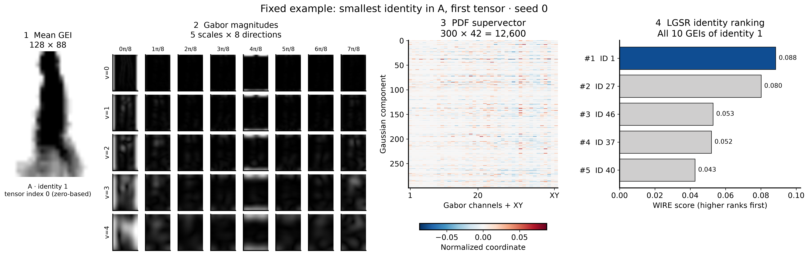
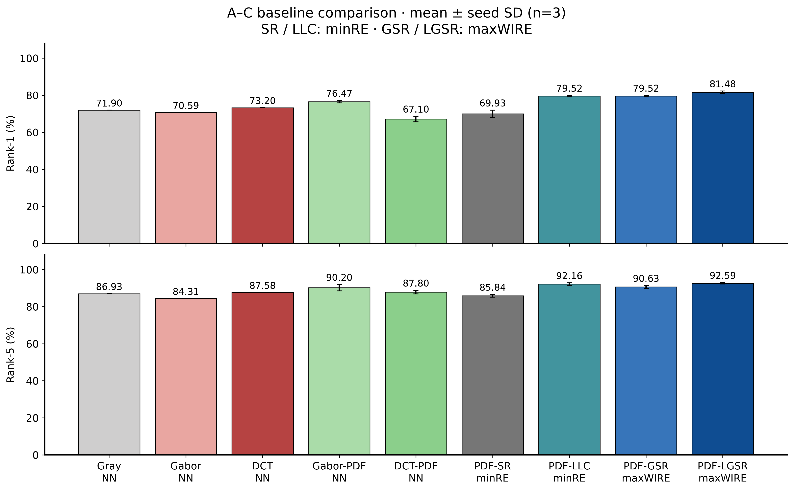
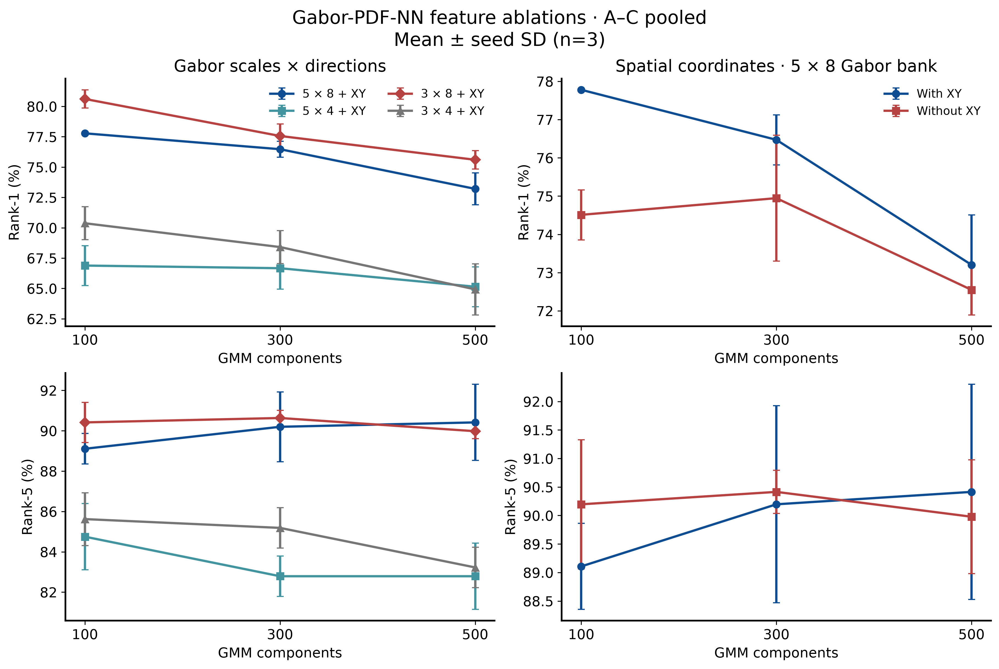
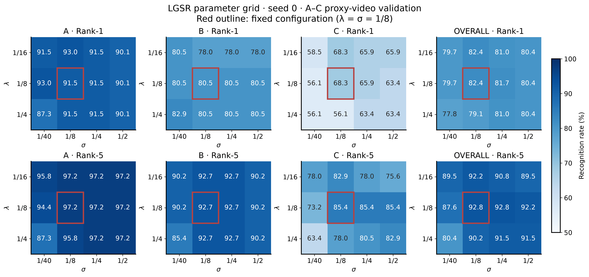
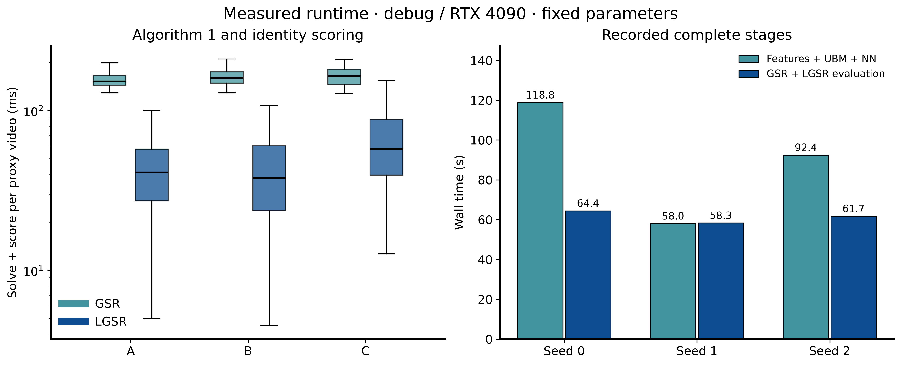

# Gabor-PDF + LGSR for Gait Recognition

Python reproduction of Xu et al., *Human Gait Recognition Using Patch Distribution Feature and Locality-Constrained Group Sparse Representation*, IEEE TIP 21(1), 316–326, 2012 ([paper](https://doi.org/10.1109/TIP.2011.2160956)). We compare nine recognition methods and evaluate 15 feature configurations over three seeds using the MPCA-preprocessed USF v1.7 data, probe sets A–C.

## Method

A walking sequence can yield several gait energy images (GEIs). The paper uses **Gabor-PDF** to describe the distribution of local features within each GEI, then applies **LGSR** to recognize several GEIs from the same video group jointly.

Gabor-PDF extracts responses at five scales and eight orientations and appends XY coordinates. A shared Gaussian mixture model (GMM) is learned from the gallery. MAP adaptation encodes each GEI as a 12,600-dimensional vector describing how its adapted means differ from the shared model. LGSR reconstructs the probe group using gallery features, with group sparsity selecting identities and local distance weights controlling their contributions.



The example uses the first tensor of identity 1 in probe A. The first three panels show one GEI, its 40 Gabor response maps, and its PDF. The final panel jointly recognizes all ten GEIs in this identity group and ranks the correct identity first.

## Main findings

Results below use 153 identity-based proxy groups across A–C and report the mean and sample standard deviation over seeds 0, 1, and 2.

- **LGSR leads the comparison with fixed parameters.** It achieves **81.48 ± 0.75% Rank-1** and **92.59 ± 0.38% Rank-5**. Rank-1 is 5.01 percentage points above Gabor-PDF-NN and 1.96 points above both LLC and GSR.
- **Feature settings have a substantial effect.** PDF-NN with three scales, eight orientations, and K=100 reaches **80.61 ± 0.75% Rank-1**. Across the evaluated grid, eight orientations consistently outperform the corresponding four-orientation configurations in mean Rank-1.
- **XY coordinates mainly improve first-rank recognition.** With the 5×8 Gabor bank, adding XY improves Rank-1 by 3.27/1.53/0.65 percentage points at K=100/300/500. The corresponding Rank-5 changes are −1.09/−0.22/+0.44 points.

## Data and protocol

Data come from a pinned [MPCA data mirror](https://github.com/zeke75/Multilinear-PCA/tree/9757930e0bbdd0b6b2f499410d9c1cbee2f3348e). Each sample contains ten frames and an identity label. We combine GEIs with the same identity within each split into a **proxy video group**. All identities in A–C appear in the gallery; D–G include label 0, which is absent from the gallery. The original paper evaluates 122 subjects using original video groups in A–L. This repository uses the A–C protocol below.

| Split | Tensors | Identities / proxy video groups |
| --- | ---: | ---: |
| Gallery | 731 | 71 |
| A | 727 | 71 |
| B | 423 | 41 |
| C | 420 | 41 |

The universal background model (UBM) is fitted on the gallery. Recognition rates pool correct predictions over all 153 probe groups. Seeds 0, 1, and 2 vary the GMM initialization; the reported mean and sample standard deviation summarize that variation. The download script pins the source commit and records file hashes. Shapes and label counts are saved in the [data manifest](results/data-manifest.json).

## Baselines and ablations

### Comparing nine methods

The table reports mean ± sample standard deviation in percent with fixed parameters. Following Table VII of the paper, SR and LLC use minRE, while GSR and LGSR use maxWIRE.

| Method | Rank-1 (%) | Rank-5 (%) |
| --- | ---: | ---: |
| Gray-NN | 71.90 ± 0.00 | 86.93 ± 0.00 |
| Gabor-NN | 70.59 ± 0.00 | 84.31 ± 0.00 |
| DCT-NN | 73.20 ± 0.00 | 87.58 ± 0.00 |
| Gabor-PDF-NN | 76.47 ± 0.65 | 90.20 ± 1.73 |
| DCT-PDF-NN | 67.10 ± 1.51 | 87.80 ± 1.00 |
| Gabor-PDF-SR | 69.93 ± 1.96 | 85.84 ± 0.75 |
| Gabor-PDF-LLC | 79.52 ± 0.38 | 92.16 ± 0.65 |
| Gabor-PDF-GSR | 79.52 ± 0.38 | 90.63 ± 0.75 |
| **Gabor-PDF-LGSR** | **81.48 ± 0.75** | **92.59 ± 0.38** |



Encoding Gabor responses as PDFs raises NN Rank-1 from 70.59% to 76.47%. With the same Gabor-PDF features, LGSR reaches 81.48%. DCT-PDF-NN achieves 67.10%, below DCT-NN's 73.20%, showing that the benefit of distribution encoding depends on the local descriptor in this experiment. LGSR Rank-1 on A/B/C is 92.02%/80.49%/64.23%; C has the lowest recognition rate of the three probe sets.

The [main metrics](results/metrics.csv) and [additional baseline metrics](results/baselines/metrics.csv) include individual seeds, probe sets, and both minRE/maxWIRE scores. The [prediction table](results/predictions.csv) records each true identity's rank and Rank-1/5 hits; result JSON files contain the complete candidate rankings.

### Gabor banks, GMM components, and XY coordinates

Following the comparisons in Tables III and V, we evaluate 15 configurations with seeds 0/1/2: four Gabor scale/orientation combinations at K=100/300/500, plus the 5×8 bank without XY at each K. The three-scale bank uses indices `[0,2,4]`; the four-orientation bank uses `[0,2,4,6]`. All configurations use PDF-NN. The default configuration reuses the main experiment results. Within each configuration, Gabor descriptors are shared across seeds, and each seed fits its own gallery UBM. Timings separate shared preprocessing, UBM fitting, MAP encoding, and NN classification.



The left panels show that eight orientations outperform four in Rank-1 at every K. For all four scale/orientation combinations with XY, mean Rank-1 falls as K increases from 100 to 500. The highest value comes from 3×8, XY, K=100, exceeding the default 5×8, XY, K=300 by 4.14 percentage points. The main comparison retains its parameters fixed before the experiments.

The right panels show that adding XY improves Rank-1 at all three K values. Rank-5 changes are smaller and vary in direction: at K=300, XY raises Rank-1 from 74.95% to 76.47%, while Rank-5 changes from 90.41% to 90.20%.

Per-configuration and per-seed values are saved in the [ablation metrics](results/ablations/metrics.csv). Each configuration directory also contains training histories, timings, and provenance.

### Effects of λ and σ

The parameter sweep uses seed 0, λ∈{1/16,1/8,1/4}, and σ∈{1/40,1/8,1/4,1/2}, evaluating three GSR and twelve LGSR configurations. Selecting the best settings using probe labels, separately for A/B/C and for Rank-1/Rank-5, gives pooled LGSR rates of **83.66% / 92.81%**. All combinations and selected settings are recorded in the [parameter grid](results/grid-metrics.csv) and [per-probe selections](results/grid-oracle.json).



Red outlines mark the main experiment's fixed setting, λ=σ=1/8. Across the grid, C's Rank-1 ranges from 56.10% to 68.29%, a wider range than A's 87.32%–92.96% or B's 78.05%–82.93%. Parameter sensitivity is strongest on C, the probe set with the lowest recognition rate.

### Solver and scoring time



Under the paper's Algorithm 1 stopping rule, median LGSR solving and scoring time per group is 41.1/37.8/57.4 ms on A/B/C, below GSR's 152.0/160.1/164.2 ms. The left panel covers Algorithm 1, class scoring, and ranking; EMD, Gram matrices, and distances are prepared before this timer starts.

The right panel shows recorded stage times across the three seeds: 58.0–118.8 s for the feature stage and 58.3–64.4 s for the recognition stage. Exact timing definitions and values are in the [timing summary](results/presentation/runtime-summary.json). Stopping rules and KKT diagnostics are described under [implementation settings](#implementation-settings).

## Implementation settings

The paper specifies the main equations and experimental configuration but leaves some numerical details open. We follow its stated settings and choose explicit values for the remaining details, as listed below.

| Item | Setting | Source and rationale |
| --- | --- | --- |
| GEI | Average each 32×22×10 tensor over time; resize bilinearly to 128×88; retain [0,1] intensities | The paper specifies 128×88; averaging and resizing adapt the available tensors |
| Gabor kernels | δ=2π, scales 0–4, orientations 0–7 | Equation (1) and the paper's configuration |
| Kernel support and response | Truncate each axis at ceil(3δ/frequency); zero padding; FFT linear convolution with same-size output; complex-response magnitude | Numerical choices for details left open in the paper |
| Downsampling and coordinates | Bilinear antialiased resizing to 64×44; XY mapped separately to [0,1]; retain Gabor channel scales | Grid size and XY follow the paper; interpolation and coordinate units are specified here |
| GMM | K=300, diagonal covariance, fitted on all gallery patches | The paper's feature pipeline and default configuration |
| Initialization | Random observations, 30 Lloyd k-means iterations; reinitialize empty clusters with the farthest observation; initial weights 1/K | K-means and uniform weights follow the paper; iteration count, seeds, and empty-cluster handling are specified here |
| EM | float64 statistics; mean log-likelihood change <1e-4; at most 500 iterations; variance floor 1e-6 | Stopping and regularization details are specified here; the iteration cap was set from gallery likelihood convergence |
| MAP | r=16; occupancy-weighted mean adaptation; weights l_k/H; covariance retained from the UBM | Adaptation follows the paper; its unspecified relevance parameter is set to 16 |
| PDF normalization | sqrt(m_k/2)×Σ_k^(-1/2)×(μ_k−UBM_μ_k); concatenate, subtract the per-vector mean, and L2-normalize | Equation (3) and the paper's normalization procedure |
| EMD | Uniform mass per GEI, total mass 1; Euclidean cost; exact transport solution by linear programming | Single-level video matching follows the paper and reference [33]; uniform masses are specified here |
| Classification parameters | Fixed λ=1/8, σ=1/8; grid λ∈{1/16,1/8,1/4}, σ∈{1/40,1/8,1/4,1/2} | The grid follows the paper; one setting was fixed before the main experiment |
| Algorithm 1 | Empty active set, S=0, Z=0 for zero blocks; add at most one group with the largest gradient norm per iteration; update in insertion order | The paper's pseudocode |
| Line search | Initial step: reciprocal of the current group's largest Gram eigenvalue; Armijo=1e-4; halve the step; at most 60 trials | Explicit settings for the paper's unspecified line-search details |
| Stopping | Frobenius norm of the coefficient change <0.001; zero blocks with norm <0.001; at most 500 iterations | Both 0.001 thresholds follow the paper; the iteration cap is specified here |
| Scoring | SR/LLC: minRE; GSR/LGSR: maxWIRE; save both scores; NN: median-of-nearest distance | The main comparison follows Table VII |
| Aggregation | Correct groups / 153; seeds 0/1/2; mean and sample standard deviation | Probe-count weighting follows the paper; group counts and seeds belong to this experiment |

Main settings are in `config.json`. Additional SR and DCT parameters are defined in `gait/run_baselines.py` and saved under `config` in `results/baselines/seed-N.json`. K-means and EM run on the GPU. Classification precomputes Gram and cross-product matrices on the GPU, then performs Algorithm 1's small block updates and EMD linear programming on the CPU.

### Algorithm 1 and stopping criteria

The paper's prose describes all groups entering the active set at zero initialization, while its pseudocode starts with an empty set. We follow the pseudocode and add at most one group per iteration. For zero groups, Equation (10) uses `||∇R_c||_F ≤ λ min(D_c)`, a sufficient condition. With general nonuniform D, the exact condition is `||∇R_c/D_c||_F ≤ λ`. We retain the paper's condition and record violations of the exact condition alongside gradient norms for nonzero blocks.

If line search finds no descent step within 60 trials, the block is retained and `stalled_blocks` is recorded. Classification ranks active groups; a sample with no active group counts as a recognition failure.

`paper_delta_tolerance` indicates that the paper's coefficient-change stopping criterion was met. KKT residuals measure optimality separately, including the nonzero residuals at termination in the main runs. Results retain full objective traces, stopping reasons, stalled-update counts, and KKT residuals. Runs reaching the iteration cap are marked `iteration_limit`.

The three main UBM fits take 261, 114, and 194 EM iterations. The [optimization plot](figures/optimization.png) shows UBM training and LGSR objective trajectories. Per-sample iterations, stopping reasons, and residuals are in the [optimization summary](results/summary.json) and `results/*-solver-*.json.gz`.

### SR, LLC, and DCT baselines

SR minimizes Equation (13), `0.5 ||y−Xs||² + λ||s||₁`. The paper gives the objective; we specify the solver and stopping threshold: fixed-step FISTA in float64, with a step equal to the reciprocal of the largest gallery Gram eigenvalue. The maximum coordinate-wise KKT residual is checked every ten iterations against 1e-6, with a 10,000-iteration cap. Coefficients are solved independently for each probe GEI, then scored with minRE/maxWIRE within the proxy groups. Results store per-GEI KKT residuals and, for each split, the batched solve's iteration count, total objective trace, and stopping reason. FISTA follows [Beck and Teboulle, 2009](https://doi.org/10.1137/080716542).

LLC follows Equation (14) and the paper's closed-form solution with a sum-to-one constraint. Local weights are `exp((distance−max(distance))/σ)`, equivalent to normalizing exponential distances by their maximum. The linear system uses the centered Gram matrix plus `2λ diag(d²)`; its solution is divided by the sum of its entries. We fix λ=σ=1/8 and record stationarity and equality-constraint residuals.

The paper specifies a 25-dimensional DCT descriptor with XY and cites reference [22]. We set the remaining window, frequency selection, boundary, and interpolation details as follows: an 8×8 orthonormal DCT-II window, retaining the low-frequency 5×5 coefficients including DC; offsets −3 through +4, with reflection padding of 3 on the left/top and 4 on the right/bottom. The 25 response maps are resized to 64×44 with bilinear antialiasing. DCT-NN concatenates these responses. DCT-PDF appends XY in [0,1] to form 27-dimensional descriptors and fits its own K=300 gallery UBM. MAP and final normalization follow the main pipeline, yielding an 8,100-dimensional PDF.

## Running the experiments

**uv** and `uv.lock` manage the environment: Python 3.12, PyTorch 2.8.0+cu128, and SwanLab 0.10.3. Experiments run on RTX 4090 GPUs in Slurm's **debug** partition, one GPU per job. The commands below cap each main and ablation array at two concurrent tasks. Gabor, GMM, and Gram computations run on the GPU; EMD and small matrix block updates run on the compute node's CPU.

Install uv and Git, configure SwanLab credentials, and run the following on a Slurm cluster:

```bash
git clone https://github.com/Carkham/gait-pdf-lgsr.git
cd gait-pdf-lgsr
mkdir -p logs
setup_job=$(sbatch --parsable slurm/setup.sbatch)
data_job=$(sbatch --parsable --dependency=afterok:${setup_job} slurm/prepare-small-data.sbatch)
main_job=$(sbatch --parsable --dependency=afterok:${data_job} --array=0-2%2 slurm/run.sbatch)
report_job=$(sbatch --parsable --dependency=afterok:${main_job} slurm/report.sbatch)
grid_job=$(sbatch --parsable --dependency=afterok:${main_job} slurm/run.sbatch --stage evaluate --seed 0 --grid)
grid_report=$(sbatch --parsable --dependency=afterok:${grid_job}:${report_job} slurm/report-grid.sbatch)
```

These jobs set up the environment, download data, extract features, evaluate recognition, and generate reports. `gait.run` supports `--stage features|evaluate|all`; evaluation reads features and settings from `artifacts/seed-N/features.pt`. After changing feature parameters, run `features` or `all`. Repeating a seed updates its output directory. Report scripts export CSV/JSON results and compressed optimization traces to `results/`, and PNG/SVG figures to `figures/`.

The additional baselines, feature ablations, and figures use the following jobs. The ablation array skips index 1 and reuses the default configuration during aggregation.

```bash
baseline_job=$(sbatch --parsable --dependency=afterok:${main_job} --array=0-2%1 slurm/baselines.sbatch)
baseline_report=$(sbatch --parsable --dependency=afterok:${baseline_job} slurm/baselines.sbatch --report)
ablation_job=$(sbatch --parsable --dependency=afterok:${main_job} --array=0,2-14%2 slurm/ablations.sbatch)
ablation_report=$(sbatch --parsable --dependency=afterok:${ablation_job} slurm/ablations.sbatch --report)
existing_figures=$(sbatch --parsable --dependency=afterok:${grid_report} slurm/report-extended.sbatch --part existing)
baseline_figures=$(sbatch --parsable --dependency=afterok:${baseline_report} slurm/report-extended.sbatch --part baselines)
ablation_figures=$(sbatch --parsable --dependency=afterok:${ablation_report} slurm/report-extended.sbatch --part ablations)
sbatch --dependency=afterok:${existing_figures}:${baseline_figures}:${ablation_figures} slurm/report-grid.sbatch
```

The final job re-exports the parameter grid and refreshes checksums for all result subdirectories and figures.

## Code and experiment records

| Path | Contents |
| --- | --- |
| `gait/features.py` | Gabor, GMM, MAP, and PDF |
| `gait/solver.py` | EMD, Algorithm 1, and minRE/maxWIRE |
| `gait/run.py` | Data loading, baselines, experiment loop, and SwanLab logging |
| `gait/baselines.py`, `gait/run_baselines.py` | DCT, DCT-PDF, SR, LLC, and three-seed comparisons |
| `gait/run_ablations.py` | Gabor, GMM, and XY ablations and aggregation |
| `scripts/`, `slurm/` | Data preparation, reporting, plotting, and cluster entry points |
| `results/`, `figures/` | Metrics, predictions, optimization traces, and figures |
| `paper-settings.json` | Original paper settings and reported values |

The [SwanLab project](https://swanlab.cn/@carkham/gait-pdf-lgsr) includes configurations, training curves, and recognition metrics for [seed 0](https://swanlab.cn/@carkham/gait-pdf-lgsr/runs/sm8pliwq), [seed 1](https://swanlab.cn/@carkham/gait-pdf-lgsr/runs/gdjmmnvl), [seed 2](https://swanlab.cn/@carkham/gait-pdf-lgsr/runs/l2trztn3), and the [parameter sweep](https://swanlab.cn/@carkham/gait-pdf-lgsr/runs/mm01g9yr). Per-seed provenance records contain data hashes, code commits, and hardware information. `results/checksums.json` stores SHA-256 hashes of results and figures. Download scripts fetch raw data; experiment scripts generate feature caches locally.

Additional baseline runs are recorded for [seed 0](https://swanlab.cn/@carkham/gait-pdf-lgsr/runs/9q8gbvog), [seed 1](https://swanlab.cn/@carkham/gait-pdf-lgsr/runs/q5pg5cmn), and [seed 2](https://swanlab.cn/@carkham/gait-pdf-lgsr/runs/h7mg1zi5). Each new ablation configuration has one SwanLab run, linked in the [ablation run index](results/ablations/runs.json), with curves and metrics under `seed0/`, `seed1/`, and `seed2/`.

## References

The method follows Xu et al., TIP 2012. The data preprocessing source is Lu, Plataniotis, and Venetsanopoulos, *MPCA: Multilinear Principal Component Analysis of Tensor Objects*, IEEE TNN 19(1), 18–39, 2008 ([MPCA paper](https://doi.org/10.1109/TNN.2007.901277)). BibTeX entries are in [paper.bib](paper.bib).

Related methods cited by the original paper:

- Reference [21]: [Lucey and Chen, CVPR 2004](https://publications.ri.cmu.edu/a-gmm-parts-based-face-representation-for-improved-verification-through-relevance-adaptation), the GMM relevance-adaptation method. We set the MAP relevance parameter to r=16.
- Reference [22]: [Flexible X-Y patches for face recognition](https://doi.org/10.1109/ICASSP.2008.4518059), the XY local-feature representation.
- Reference [33]: [Xu and Chang, TPAMI 2008](https://www.ee.columbia.edu/ln/dvmm/publications/08/pami_xu_08.pdf), single-level EMD video matching. We assign uniform mass to each GEI.
